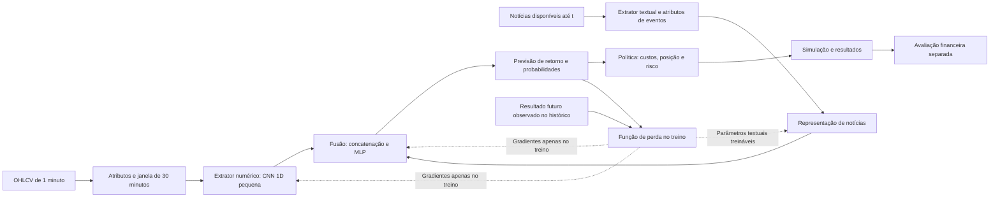

# Arquitetura neural e ferramentas

Data: 27/10/2026. Decisão solicitada pelo usuário: adotar a arquitetura de extratores, combinação por pesos e treinamento orientado ao erro.

## Arquitetura funcional definida

Rede neural multimodal supervisionada, com dois ramos de entrada, fusão aprendida e política de decisão separada. O treinador calcula erro e atualiza os parâmetros; não é uma terceira rede que recebe dados futuros durante a operação. Quantidade de camadas e dimensões são hipóteses de implementação a validar, não reprodução literal de cada círculo do desenho.



### Bloco 1: extratores

- Mercado: janelas com 30 candles OHLCV de um minuto. Produzir retornos, amplitudes, corpo/pavios, volume relativo e derivadas causais com disponibilidade explícita. Linha e velas são representações dos mesmos dados; não presumir fontes independentes.
- Extrator numérico inicial: convolução temporal 1D pequena em PyTorch. Usar somente informações encerradas até t. Comparar com MLP simples e referências estatísticas para justificar a escolha.
- Notícias: documentos originais, fonte, publicação, disponibilidade, categoria, entidades, idade do evento e duplicatas. Encoder textual pré-treinado pequeno via Transformers, inicialmente congelado e com representações pré-calculadas. Escolher checkpoint, idioma, licença e avaliação antes de baixá-lo. SLM generativa não é requisito para esta versão.
- Os doze documentos pesquisados até agora são um catálogo explicativo de extremos; não constituem corpus suficiente para treinar o ramo textual. Distinguir ausência comprovada de notícias de falta de cobertura histórica. Não transformar histórico ausente em sinal de que não houve evento.

### Bloco 2: fusão e previsão

Concatenar representações numéricas e textuais, atributos de eventos e indicadores de cobertura. Uma MLP aprende interações não lineares. Os pesos são parâmetros do modelo; não equivalem a um coeficiente causal fixo para cada tipo de notícia. Relevância semântica, confiabilidade da fonte e resposta financeira precisam de definições distintas.

Alvo inicial de pesquisa: retorno logarítmico do fechamento disponível em t ao fechamento em t+30 minutos. A janela de entrada continua sendo os 30 minutos anteriores. A escolha de horizonte de previsão é configurável e deve ser comparada somente na validação. Cada rótulo exige cobertura contínua até seu fim; rejeitar rótulos atravessando lacunas.

Implementar primeiro uma cabeça de regressão. Uma cabeça de classes queda/estável/alta pode ser comparada depois, com limiares pré-especificados em relação a custos e avaliação de calibração. Softmax isolada não garante probabilidade calibrada. O alvo de preço não é automaticamente o resultado de uma ordem preenchida na abertura seguinte.

### Bloco 3: treinador e avaliador

Treinamento em PyTorch com função de perda explícita, autograd e otimizador AdamW. Para regressão, comparar erro quadrático e Huber na validação. Early stopping e checkpoints mantêm a melhor versão segundo critério definido antes da busca. Não atualizar pesos até acertar cada caso, nem selecionar pela rentabilidade máxima no teste.

Treino ajusta pesos. Validação escolhe configurações e momento de parar. Teste final avalia o modelo congelado. Normalizadores são ajustados somente no treino; rótulos que ultrapassam fronteiras são excluídos. Nosso levantamento de extremos examinou todo o histórico: escolhas inspiradas nesses resultados precisarão de período novo intocado ou avaliação prospectiva antes de alegar teste independente.

A política de ação usa previsão, custos, posição atual, tamanho e limites. Avaliação financeira considera taxa, slippage, giro e drawdown. Resultados da simulação não substituem a função de perda por retropropagação de uma decisão discreta. Aprendizado por reforço e otimização diferenciável de operações são mudanças de escopo posteriores.

## Ferramentas escolhidas

| Ferramenta | Uso |
| --- | --- |
| Python e .venv | Ambiente de execução e dependências isoladas |
| NumPy | Atributos matemáticos e interface com tensores |
| Polars e Parquet | Ler, transformar e armazenar o histórico eficientemente; CSV original preservado |
| PyTorch | CNN 1D, MLP de fusão, autograd, perdas, otimizador e checkpoints |
| scikit-learn | Normalização no treino, referências simples, métricas e calibração temporalmente controlada |
| Hugging Face Transformers | Carregar encoder textual pré-treinado compatível; biblioteca não fornece automaticamente dados/notícias |
| TensorBoard | Curvas de treino/validação e métricas por execução |
| Matplotlib | Figuras exportáveis de previsões, erros e desempenho |
| unittest, Git, JSON/YAML e SHA-256 | Verificação, código, configuração e rastreabilidade |

Não precisamos escolher banco distribuído, Kubernetes, plataforma de agentes, interface web ou GPU em nuvem para validar o primeiro modelo. Registro inicial de experimentos será local: configuração, sementes, corte temporal, hashes, métricas e checkpoint, com curvas em TensorBoard. Ferramentas adicionais entram por necessidade concreta.

## Ambiente verificado e preparação

Windows, Python 3.14.7, aproximadamente 15,9 GiB de RAM e NVIDIA GeForce GTX 1650 com aproximadamente 4 GiB de VRAM reportados pelo sistema. NumPy 2.5.4 e Matplotlib 3.11.2 já instalados na .venv. Pacotes escolhidos devem ser instalados e verificados na mesma .venv. Não alterar Python global ou drivers.

Preparar inicialmente o wheel oficial PyTorch CPU compatível com Python 3.14. Isso permite validar a rede e o treinamento sem depender da configuração CUDA. A placa foi detectada, mas treinamento CUDA não foi validado; resultado cuda.is_available() de um wheel CPU não demonstra incompatibilidade física da placa. Planejar ensaio GPU separado se o tempo de treino justificar, verificando driver e arquitetura suportada pelo wheel antes de mudar a instalação.

Não baixar pesos de modelos de linguagem sem selecionar checkpoint adequado. Não iniciar treinamento financeiro antes da construção dos rótulos e do protocolo temporal. A instalação de bibliotecas prepara as ferramentas, sem significar que a rede multimodal já esteja implementada ou treinada.

## Sequência de implementação

1. Instalar as bibliotecas escolhidas, verificar imports, leitura CSV/Parquet, autograd, atualização de pesos e geração de logs. Registrar versões e verificações.
2. Construir dataset supervisionado de preços com rótulos futuros e divisão temporal sem vazamento. Consolidar corpus de notícias com instante de disponibilidade; desenvolver o ramo numérico enquanto essa coleta prossegue.
3. Implementar referência simples e CNN 1D numérica, com treinamento reproduzível, validação e checkpoints.
4. Integrar extrator de notícias e fusão; medir separadamente preço apenas, notícias apenas e combinação. Não apresentar ramo textual sem corpus como treinado.
5. Avaliar decisões após custos e acompanhamento prospectivo. Considerar modelo pronto para próxima etapa apenas conforme critérios definidos de generalização e execução, não pela simples convergência da perda.

## Documentação primária consultada

- PyTorch, instalação e requisitos: https://pytorch.org/get-started/locally/
- Conv1d: https://docs.pytorch.org/docs/stable/generated/torch.nn.Conv1d.html
- TensorBoard com PyTorch: https://docs.pytorch.org/docs/stable/tensorboard.html
- Polars, operações e formatos: https://docs.pola.rs/
- scikit-learn, calibração: https://scikit-learn.org/stable/modules/calibration.html
- scikit-learn, divisão temporal: https://scikit-learn.org/stable/modules/generated/sklearn.model_selection.TimeSeriesSplit.html
- Transformers, instalação: https://huggingface.co/docs/transformers/en/installation

Nenhum commit sem entendimento humano, conforme Agents.md.

## Preparação concluída

Instalados na .venv: PyTorch 2.14.1+cpu pelo índice oficial, scikit-learn 1.9.1, Polars 2.1.0, Transformers 5.21.0 e TensorBoard 2.21.0. NumPy 2.5.4 e Matplotlib 3.11.2 foram preservados. As dependências estão em requirements-torch-cpu.txt e requirements-ml.txt; a primeira instalação usa o índice oficial CPU em comando separado, e a segunda usa PyPI.

```powershell
.venv/Scripts/python.exe -m pip install -r requirements-torch-cpu.txt
.venv/Scripts/python.exe -m pip install -r requirements-ml.txt
.venv/Scripts/python.exe App/verify_ml_environment.py
.venv/Scripts/python.exe -m pip check
.venv/Scripts/python.exe -m unittest discover -s App -p "test_*.py" -v
```

App/verify_ml_environment.py verificou atualização de pesos e gradientes finitos com AdamW em problema sintético, execução de Conv1d, forward de encoder BERT mínimo aleatório sem download, normalização, métricas, preservação de amostra CSV/Parquet e gravação TensorBoard. O erro sintético caiu de 2,6926 para 0,000290; esse resultado comprova somente funcionamento do mecanismo, sem informação sobre previsão financeira. pip check não encontrou dependências quebradas.

Relatório local e logs: App/results/environment_check/report.json e App/results/environment_check/tensorboard. Nenhum modelo financeiro foi treinado, nenhum checkpoint pré-treinado foi baixado e CUDA não foi validado. Próxima entrega de implementação: dataset supervisionado numérico, protocolo temporal e primeiro treinamento de referência; corpus de notícias e encoder selecionado continuam necessários para completar a modalidade textual.
