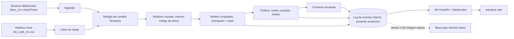

# Interface de operação ao vivo e replay

Data: 28/10/2026. Pedido do usuário: ver o modelo operando no gráfico, onde comprou, o que aconteceu depois, se saiu na hora certa e se deu lucro ou prejuízo, além do que o modelo está "pensando", sua decisão e sua confiança.

## Objetivo

Uma interface web local que mostra, sobre o gráfico real do BTC/USDT, cada decisão do modelo, cada ordem simulada e o resultado de cada operação depois dos custos. A mesma interface funciona em dois modos com o mesmo código de decisão:

- **Replay:** reproduz o histórico já coletado minuto a minuto, com controle de velocidade. Permite ver o modelo operando hoje, antes de existir conexão ao vivo, e testar a interface sem esperar o mercado.
- **Ao vivo (paper trading):** recebe candles fechados da Binance em tempo real e simula as ordens. Nenhum dinheiro real e nenhuma credencial de corretora nesta fase.

Princípio central: tudo que aparece na tela é um registro do que o motor decidiu no instante em que decidiu. A interface nunca recalcula decisões passadas com dados posteriores. Métricas retrospectivas, como "melhor saída possível", só aparecem depois que a operação terminou e ficam marcadas como retrospectivas.

## Arquitetura



### Componentes

1. **Ingestão ao vivo:** stream público `btcusdt@kline_1m` da Binance; só candles com `x = true` (fechados) entram. Stream `btcusdt@bookTicker` registra melhor compra e venda para estimar slippage real. Reconexão automática; ao reconectar, preenche minutos perdidos pela API REST `klines`. Sem chave de API.
2. **Leitor de replay:** lê o histórico local e entrega um candle por vez ao mesmo relógio, na velocidade escolhida. O motor não sabe se está em replay ou ao vivo.
3. **Relógio de candles:** garante ordem, detecta lacunas e atraso. Com lacuna dentro da janela de 30 minutos, o modelo não decide e o registro diz "sem decisão: lacuna", em vez de inventar dados.
4. **Atributos e modelo:** importam o mesmo módulo usado no treino, para que a entrada ao vivo seja idêntica à do treino. O checkpoint é carregado uma vez, com hash SHA-256 registrado em cada decisão.
5. **Política:** transforma previsão em ação somente quando o retorno esperado supera os custos de ida e volta e um limiar de confiança. A regra e seus parâmetros ficam registrados com a decisão.
6. **Corretora simulada:** mesma convenção de `quantlab.py`: decisão no fechamento de t, execução na abertura de t+1, taxa em cada lado, slippage desfavorável. Acrescenta posição vendida, stop e alvo, conforme as decisões do usuário abaixo. Ao vivo, usa também o spread observado no bookTicker no instante da execução, registrando os dois custos.
7. **Log de eventos:** SQLite da biblioteca padrão, uma tabela por tipo de evento, somente acréscimo. Toda sessão pode ser auditada e reproduzida. É também o futuro conjunto de dados de retreino, separado do teste.
8. **API e interface:** FastAPI entrega o estado inicial por HTTP e empurra eventos novos por WebSocket. A interface é HTML e JavaScript servidos pelo próprio backend, sem etapa de build com Node, para rodar no Windows com `python` apenas.

### Registros gravados

| Evento | Campos principais |
| --- | --- |
| candle | abertura UTC, OHLCV, fonte, recebido_em, atraso |
| decisao | disponível_em, id da janela, versão do modelo (hash), retorno previsto t+30, intervalo de previsão, stop e alvo previstos, probabilidades alvo/stop/tempo esgotado, confiança calibrada, ação, motivo em texto, custo estimado, latência de inferência, atribuições por minuto |
| ordem | id, decisão de origem, lado, quantidade, preço de referência |
| execucao | id da ordem, preço executado, taxa, slippage modelado, spread observado |
| posicao | após cada minuto: unidades, preço médio, resultado não realizado líquido |
| operacao | lado (comprada ou vendida), entrada, saída, stop e alvo, duração, bruto, custos, custo de empréstimo, cotação USDTBRL, líquido em USDT e R$, motivo de entrada, saída por (alvo, stop, tempo, modelo) |
| patrimonio | a cada minuto: caixa, posição marcada, patrimônio, referência compra-e-mantém |
| alerta | lacuna, desconexão, atraso, mudança de distribuição |

## Telas

### 1. Painel principal

```text
+-----------------------------------------------------------------------------------+
| SIMULAÇÃO - nenhum dinheiro real | Modo: REPLAY 10x | Modelo v3 a1b2c3 | 14:31 UTC |
+--------------------------------------------------------+--------------------------+
|                                                        | O QUE O MODELO VÊ AGORA  |
|  Gráfico de candles 1m BTC/USDT                        | Previsão 30m: +0,42%     |
|   ── alvo 67.610 (verde tracejado)                     | Faixa 80%: -0,3% a +1,1% |
|   ▲ compra 67.120 (seta verde no candle da execução)   | Alvo 1º 45% Stop 1º 25%  |
|   ── preço de entrada        ── ponto de empate        | Tempo esgota 30%         |
|   ── stop 66.850 (vermelho tracejado)                  | Valor esperado: +R$ 0,09 |
|   ░░ faixa da posição aberta (verde lucro/vermelho)    | Confiança calibrada: 58% |
|   ⋯⋯ cone de previsão para os próximos 30 minutos      | "quando disse 58%,       |
|   ✕ saída 67.480 (X no candle da saída)                |  acertou 55% (n=812)"    |
|                                                        | DECISÃO: MANTER          |
|  [mapa de atribuição: quais minutos pesaram mais]      | Motivo: previsão > custo |
|                                                        | Notícias na janela: 0    |
+--------------------------------------------------------+ Dados: OK, atraso 0,8 s  |
|  Patrimônio: estratégia vs compra-e-mantém vs caixa    +--------------------------+
|  Drawdown                                              | POSIÇÃO: COMPRADA R$ 50  |
|                                                        | Entrada 14:02 a 67.120   |
|                                                        | Agora +0,31% (+R$ 0,16)  |
|                                                        | Líquido após custos      |
|                                                        |   +0,01% (+R$ 0,01)      |
|                                                        | Tempo: 29 de 30 min      |
|                                                        | Até o alvo +0,42%        |
|                                                        | Até o stop -0,71%        |
|                                                        | Melhor até agora +0,52%  |
|                                                        | Pior até agora -0,18%    |
+--------------------------------------------------------+--------------------------+
| Saldo acumulado: +R$ 1,37 em 24 operações | 13:10 ▼vendida alvo +R$ 0,11 | ...  |
+-----------------------------------------------------------------------------------+
```

Elementos do gráfico:

- Candles de 1 minuto com zoom e arraste; atalhos para 30 min, 4 h, 1 dia.
- Seta verde para cima na entrada comprada e vermelha para baixo na entrada vendida, com um X na saída, no candle de execução, com o preço executado e a dica "decidido às 14:01 no fechamento, executado às 14:02 na abertura".
- Linhas horizontais durante a posição: preço de entrada, ponto de empate (entrada mais custos de ida e volta), alvo em verde tracejado e stop em vermelho tracejado. Na saída, um rótulo diz o que a encerrou: alvo, stop, tempo esgotado ou decisão do modelo. Sem o ponto de empate, uma operação "acima da entrada" parece lucro e pode ser prejuízo.
- Faixa sombreada do intervalo da posição, verde quando o resultado líquido é positivo e vermelha quando negativo.
- Cone de previsão: a partir do candle atual, linha do retorno previsto para 30 minutos e faixa do intervalo. Depois de 30 minutos, o cone antigo fica esmaecido e a linha real é desenhada por cima, mostrando o que de fato aconteceu.
- Mapa de atribuição abaixo dos candles: intensidade de quanto cada um dos 30 minutos da janela influenciou a previsão. Rótulo fixo: "influência no modelo, não causa no mercado".

Painel "o que o modelo vê agora":

- Retorno previsto, intervalo de previsão e probabilidades.
- Confiança calibrada sempre acompanhada do histórico real daquela faixa e do tamanho da amostra. Sem amostra suficiente, mostra "confiabilidade ainda desconhecida" em vez de um número.
- Decisão e motivo em linguagem simples, por exemplo: "AGUARDAR: previsão +0,15% não cobre o custo estimado de 0,30%".
- Estado dos dados: último candle, atraso, lacunas, conexão. Qualquer problema deixa o painel em amarelo e suspende novas entradas.
- Alerta de mudança de regime quando a volatilidade ou a distribuição recente dos atributos fica fora da faixa vista no treino.

### 2. Diário de operações

Tabela com uma linha por operação fechada, filtrável por período, resultado e motivo:

| Coluna | Significado |
| --- | --- |
| Lado | comprada ou vendida |
| Entrada e saída | horários UTC e local, preços executados |
| Stop e alvo | níveis previstos na entrada e qual deles encerrou a operação |
| Duração | minutos na posição |
| Resultado bruto e líquido | em R$, USDT e %, com taxa, slippage, custo de empréstimo e efeito do câmbio separados |
| Motivo | por que entrou e por que saiu, copiado do registro da decisão |
| Previsão na entrada vs realizado | retorno previsto para 30 min contra o que aconteceu |
| Melhor e pior excursão | maior ganho e maior perda não realizados durante a operação |
| Eficiência da saída | quanto do melhor movimento disponível durante a posição foi capturado |
| E se? | resultado se tivesse saído 5, 15 ou 30 minutos antes ou depois |

As colunas "eficiência da saída" e "e se?" usam preços posteriores à decisão. São retrospectivas, calculadas somente após o fechamento da operação, ficam em uma área separada da tabela e nunca alimentam o modelo ou a política.

### 3. Detalhe de uma operação

Ao clicar em uma operação:

- Gráfico ampliado de 60 minutos antes da entrada até 60 minutos depois da saída.
- Cone de previsão do momento da entrada sobreposto ao caminho real.
- Linha do tempo minuto a minuto durante a posição: previsão, confiança e decisão "manter" ou "vender" em cada minuto. Mostra exatamente quando o modelo mudou de ideia.
- Estado completo do modelo nas decisões de entrada e saída: janela de entrada, atribuições, notícias, custos e regra aplicada.
- Botão "reproduzir esta operação" no modo replay.

### 4. Desempenho e confiabilidade

- Resultado acumulado líquido, comparado com compra-e-mantém, com a estratégia de médias móveis atual e com ficar em caixa.
- Resultado separado por lado (comprada e vendida) e por tipo de saída (alvo, stop, tempo, modelo); quantas vezes stop e alvo caíram no mesmo candle.
- Calibração das probabilidades de alvo e stop: quando o modelo disse 45% de alvo primeiro, com que frequência isso ocorreu.
- Taxa de acerto, ganho médio, perda média, fator de lucro, drawdown máximo, giro e parcela do resultado consumida por custos.
- Intervalo de confiança por bootstrap das métricas e número de operações. Com poucas operações, a tela avisa que o resultado ainda é compatível com sorte.
- Diagrama de calibração: para cada faixa de confiança, a frequência real de acerto. É a resposta direta para "quando ele diz 70%, acerta 70%?".
- Dispersão previsto contra realizado e erro móvel ao longo do tempo, para detectar degradação.
- Distribuição dos resultados por operação e por hora do dia.

### 5. Controles do replay

- Escolha do período, mostrando a qual divisão ele pertence (treino, validação, teste).
- Velocidades 1x, 10x, 60x e máxima; pausar, avançar um candle, voltar ao início.
- O teste final fica bloqueado por padrão. Usá-lo exige confirmação explícita e fica registrado, porque olhar o teste repetidamente o transforma em validação.

### 6. Modelos (fase posterior)

Comparação lado a lado do modelo em uso e de candidatos operando em simulação nos mesmos candles: versão, hash, período de treino, métricas e calibração. Um candidato só substitui o atual por decisão humana registrada.

## Regras de honestidade da interface

- Faixa permanente "SIMULAÇÃO - nenhum dinheiro real" enquanto não houver corretora.
- Resultados sempre líquidos de taxa e slippage, com o bruto ao lado.
- Horários em UTC com o horário local entre parênteses.
- Nenhuma informação futura no painel de decisão; métricas retrospectivas separadas e rotuladas.
- Confiança sem calibração suficiente aparece como desconhecida.
- Cada número clicável leva ao registro que o originou.

## Fases e critérios de aceitação

### Fase 0: replay com a estratégia atual

Funciona antes da rede neural: usa as médias móveis de `quantlab.py` como "modelo" provisório sobre o histórico real.

- Motor, log de eventos, API e telas 1, 2, 3 e 5, sem previsão nem calibração.
- As médias móveis não preveem stop e alvo; nesta fase eles são placeholders calculados por múltiplos fixos da volatilidade recente, identificados como tais na tela. Venda descoberta já é simulada.
- O motor trata lacunas não decidindo e registrando o motivo; resolve a limitação do simulador que hoje rejeita o histórico com lacunas.
- Aceitação: com venda descoberta, stop e alvo desligados, em qualquer período sem lacunas, as operações do replay são idênticas às de `quantlab.simulate` com os mesmos dados e parâmetros. Teste automatizado compara os dois. Stop, alvo e posição vendida têm testes com resultados calculados à mão, incluindo stop e alvo no mesmo candle e abertura além do stop.

### Fase 1: replay com a rede treinada

- Previsão, intervalo, probabilidades, atribuições e calibração; tela 4.
- Replay somente sobre a validação por padrão.
- Aceitação: a decisão registrada no replay é idêntica à previsão do mesmo checkpoint calculada em lote; teste de causalidade confirma que acrescentar candles futuros não altera decisões passadas.

### Fase 2: ao vivo em paper trading

- Ingestão Binance, reconexão, preenchimento por REST, bookTicker e alertas.
- Aceitação: uma semana contínua sem decisão com dado incompleto; cada desconexão aparece no log; latência do fechamento do candle até a decisão na tela abaixo de 5 segundos.

### Fase 3: retreino supervisionado

- Rótulos t+30 anexados aos registros quando ficam disponíveis; retreino periódico fora do processo ao vivo; candidatos comparados na tela 6.
- Dados ao vivo usados no retreino deixam de contar como teste independente; o período de avaliação seguinte precisa ser novo.

## Ferramentas

| Ferramenta | Uso |
| --- | --- |
| FastAPI e uvicorn | API HTTP e WebSocket local |
| websockets | Cliente do stream público da Binance |
| SQLite (biblioteca padrão) | Log de eventos somente acréscimo |
| TradingView Lightweight Charts (Apache 2.0) | Candles, marcadores, linhas e faixas no navegador |
| PyTorch | Inferência do checkpoint congelado, CPU |
| Captum | Atribuições por Integrated Gradients para o ramo numérico |

A interface roda em `http://localhost`, sem expor portas à internet.

## Decisões do usuário (28/10/2026)

1. **Compra e queda:** o modelo pode abrir posição comprada (ganha na alta) ou vendida (ganha na queda). Uma posição por vez; para inverter, fecha a atual e abre a oposta, pagando os custos das duas ordens.
2. **Todo o capital da operação:** cada entrada usa o valor inteiro destinado à operação, sem frações e sem alavancagem.
3. **Stop e alvo previstos pelo modelo:** cada entrada nasce com um preço de stop de perda e um preço de alvo de ganho previstos pelo modelo para aquela situação. A posição termina no stop, no alvo, no fim do horizonte de 30 minutos ou por nova decisão do modelo, o que vier primeiro.
4. **R$ 50 por operação:** cada operação usa R$ 50 fixos. O resultado de cada uma se acumula num saldo separado e não é reinvestido; a operação seguinte usa de novo R$ 50. Valores exibidos em reais.

Interpretação a confirmar: itens 2 e 4 foram lidos juntos como "todo o capital de cada operação é R$ 50".

### Consequências da venda descoberta

- No mercado à vista, vender sem ter a moeda exige margem (empréstimo com juros) ou contrato futuro perpétuo (taxa de financiamento a cada 8 horas e risco de liquidação). A simulação usa os preços à vista já coletados, sem alavancagem, e cobra um custo de empréstimo configurável por hora em posição vendida, registrado separadamente. O valor inicial é uma hipótese e precisa ser substituído pela taxa real do produto escolhido antes de qualquer conclusão.
- Na posição vendida, a perda cresce quando o preço sobe e não tem limite teórico; o stop obrigatório limita a perda simulada, mas um salto de preço pode executá-lo pior que o previsto.
- Execução real de venda descoberta, com conta de margem ou futuros, fica fora deste plano.

### Como o modelo prevê stop e alvo

Acréscimo à arquitetura de `Arquitetura neural e ferramentas.md`, mantendo o mesmo extrator e fusão:

1. **Cabeça de excursões:** prevê quantis da maior alta e da maior queda do preço nos próximos 30 minutos, com perda quantílica (pinball). Para posição comprada, o alvo vem do quantil da maior alta e o stop do quantil da maior queda; para vendida, o inverso. Os quantis usados são escolhidos na validação, antes do teste.
2. **Cabeça de desfecho:** para os níveis de stop e alvo da etapa 1, prevê a probabilidade de três desfechos: alvo primeiro, stop primeiro ou nenhum dos dois até 30 minutos (método de barreira tripla). Os rótulos usam níveis da etapa 1 gerados fora da amostra de cada bloco de treino, para o rótulo não depender de um modelo que já viu aquele dado.
3. **Política:** entra comprado, vendido ou aguarda conforme o valor esperado em reais: probabilidade do alvo × ganho até o alvo − probabilidade do stop × perda até o stop + resultado esperado no tempo esgotado − custos. Só entra se esse valor for positivo com margem definida na validação.

### Limites da simulação de stop e alvo com candles de 1 minuto

- Stop e alvo são verificados pela máxima e mínima de cada candle após a entrada. Quando os dois ficam dentro do mesmo candle, não há como saber qual veio primeiro: a simulação assume o stop primeiro (hipótese conservadora) e conta quantas vezes isso ocorreu.
- Se a abertura de um candle já ultrapassa o stop, a execução é na abertura, pior que o stop, com slippage.
- Ao vivo, stop e alvo são acompanhados pelo stream de negociações, mas a simulação continua registrando qual regra disparou a saída.

### Reais e custos de R$ 50

- O mercado é BTC/USDT. A conversão para reais usa o par USDTBRL da Binance no minuto da execução, registrado em cada operação. A variação do dólar também afeta o resultado em reais e aparece separada. Para o replay é preciso coletar o histórico de USDTBRL com o mesmo coletor; períodos sem esse histórico mostram valores em USDT.
- Com taxa de 0,10% por lado e slippage de 0,05%, a ida e volta custa cerca de 0,30%, ou R$ 0,15 por operação de R$ 50. O alvo previsto precisa superar esse custo para a entrada fazer sentido; a política já exige isso.
- R$ 50 fica acima do valor mínimo de ordem da Binance, mas o mínimo é verificado na fase ao vivo.

## Fontes

- Guo et al. (2017), *On Calibration of Modern Neural Networks*, ICML: redes modernas tendem a ser mal calibradas; justifica o diagrama de calibração e a confiança calibrada.
- Angelopoulos e Bates (2023), *Conformal Prediction: A Gentle Introduction*, Foundations and Trends in Machine Learning 16(4): intervalos de previsão com cobertura controlada; base do cone de previsão.
- Koenker e Bassett (1978), *Regression Quantiles*, Econometrica 46(1): perda quantílica usada na cabeça de excursões.
- López de Prado (2018), *Advances in Financial Machine Learning*, Wiley, cap. 3: método de barreira tripla para rótulos com stop, alvo e limite de tempo.
- Sundararajan, Taly e Yan (2017), *Axiomatic Attribution for Deep Networks*, ICML: Integrated Gradients, usado no mapa de atribuição.
- Perold (1988), *The Implementation Shortfall: Paper versus Reality*, Journal of Portfolio Management 14(3): diferença entre preço de decisão e preço executado; motiva registrar ambos.
- Bailey e López de Prado (2014), *The Deflated Sharpe Ratio*, Journal of Portfolio Management 40(5): resultados de muitas tentativas superestimam desempenho; motiva bloquear o teste e mostrar incerteza.
- Documentação oficial Binance Spot API, WebSocket Streams e Market Data endpoints: formato de `kline_1m`, `bookTicker` e `klines` REST.

## Execução (28/10/2026)

Implementadas as fases 0 e 1 sobre o checkpoint `Modelos/numerico_v1`, e a ingestão da fase 2:

- `App/trading_engine.py`: motor único, corretora simulada com R$ 50 fixos, compra e venda descoberta, custo de empréstimo, stop, alvo, saída por tempo e por lacuna, desfecho das previsões e revisão retrospectiva tardia.
- `App/trading_models.py`: médias móveis do quantlab e CNN v1, conferida pelo hash do relatório, decidindo nas mesmas janelas de 30 minutos do treino, com Integrated Gradients.
- `App/trading_sources.py` e `App/trading_server.py`: replay do CSV local, stream público da Binance com preenchimento por REST, câmbio causal, log SQLite somente acréscimo, API e WebSocket.
- `App/interface/`: painel, diário, detalhe e desempenho, com Lightweight Charts 4.2.3 incluído localmente (Apache 2.0, integridade npm conferida).

Verificação: 29 testes novos, 72 no total. O motor reproduz exatamente as operações de `quantlab.simulate` e o retorno composto de `train_numeric.simulated_policy` nas configurações equivalentes. Interface conferida no Chromium com dados sintéticos gerados só para o teste, sem erros de console.

Diferenças em relação ao plano:

- Stop e alvo são provisórios (múltiplos da volatilidade). A cabeça de excursões e a de desfecho exigem novo treinamento com os dados locais; o motor já aceita distâncias de stop e alvo vindas do modelo.
- Integrated Gradients implementado diretamente em PyTorch (32 passos, base na média do treino), sem a dependência Captum.
- O cone de previsão é uma linha: a faixa de previsão conformal precisa dos resíduos de validação, que estão só na máquina local. Coleta do spread pelo bookTicker ficou para a fase 2 completa.
- Conexão ao vivo não testada contra a Binance: o ambiente de desenvolvimento bloqueia o acesso. Histórico USDTBRL para replay em reais ainda não é coletado; aceita CSV ou cotação fixa declarada como hipótese.
